<div align="center">


# Gesture Studio

**Real-time hand gesture recognition that runs entirely in the browser.**<br/>
33 gestures · both hands tracked in 3D · trained on 1.3M hands · nothing leaves the device.

[](https://github.com/Harishik/Hand-Gesture-Recognition/actions/workflows/ci.yml)

-86.4%25%20when%20detected-7fa8ff)


<br/>

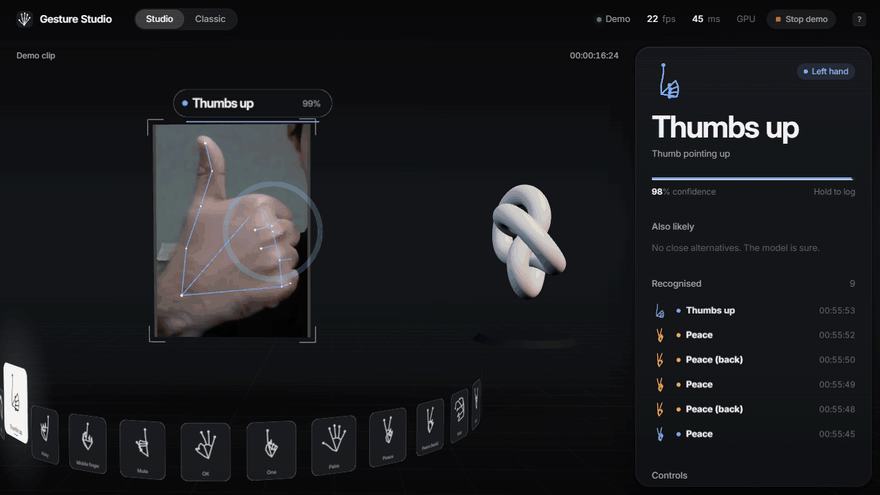

<sub>Real recording of the app (the bundled demo clip stands in for a webcam). Regenerate with <code>web/tests/record.mjs</code> + <code>scripts/make_gif.py</code>.</sub>

<br/>

<table>
<tr>
<td align="center" width="25%"><h3>33</h3><sub>gestures, one and two hands, plus swipes and pinch</sub></td>
<td align="center" width="25%"><h3>98.8%</h3><sub>accuracy on people never seen in training</sub></td>
<td align="center" width="25%"><h3>~1&nbsp;ms</h3><sub>classifier time per frame, in plain JavaScript</sub></td>
<td align="center" width="25%"><h3>0&nbsp;bytes</h3><sub>of video uploaded: there is no server</sub></td>
</tr>
</table>

[**Quick start**](#quick-start) · [**Features**](#features) · [**How it works**](#how-it-works) · [**Results**](#results) · [**Engineering**](#engineering-notes) · [**Project layout**](#project-layout)

</div>

---

## Quick start

```bash
git clone https://github.com/Harishik/Hand-Gesture-Recognition.git
cd Hand-Gesture-Recognition
python scripts/serve_web.py          # serves web/ on http://localhost:8765 (any static server works)
```

Open **http://localhost:8765** in Chrome or Edge (tested in Chrome; other modern browsers should work), press **Turn on camera** and allow access. No webcam? Press **Watch the demo**. There is no build step and nothing to install for the web app: models are plain JSON, and MediaPipe and Three.js load from a CDN.

> [!NOTE]
> Browsers only grant cameras to `https://` pages and `localhost`. Built-in browsers inside other apps often block cameras entirely; the app detects this and offers to open itself in your normal browser.

## Features

<table>
<tr>
<td width="50%" valign="top">

### 🧊 3D Studio · `index.html`

Your camera feed becomes a screen inside a 3D scene, and your hands are drawn over it as 3D skeletons with real depth: cobalt for the left hand, amber for the right.

- **Gesture ring:** all 33 gestures on a carousel; the one you hold turns to face you
- **Hologram:** a fist grabs and turns it, two open hands resize it, a pinch changes its finish
- **Recognition panel:** live confidence, hold progress, close alternatives and a log of confirmed gestures
- **Parallax camera** that follows your index finger

</td>
<td width="50%" valign="top">

### 🎛️ Classic · `classic.html`

A workbench for using gestures as an input device.

- **Action bindings:** map any gesture to any action, saved in the browser
- **Teach a gesture:** record your own pose in 3 seconds, recognised in the model's learned embedding
- **Air cursor:** your index fingertip points, a pinch clicks any control, pinch-and-drag moves sliders
- **Control deck:** a hand inspector, a live explainer and a synthesised music player, all hand-driven

</td>
</tr>
</table>

<p align="center">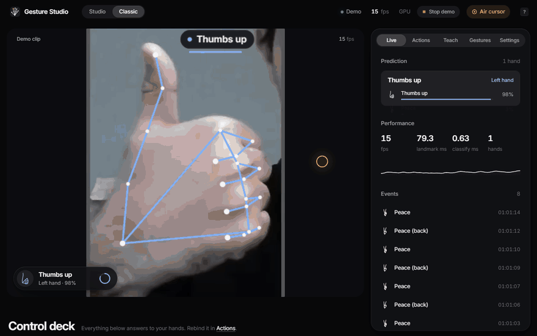</p>

<details>
<summary><b>What's on the Classic control deck</b></summary>

| Card | What it shows | Driven by |
|---|---|---|
| **Hand inspector** | Your hand in true 3D (MediaPipe world landmarks, in metres), orbitable, with live finger bend in degrees, hand span (cm), pinch gap (mm) and palm length. Measured in 3D, so the numbers hold at any distance from the camera. | Every frame |
| **How it works** | Five slides, each running one stage of the pipeline on your own hand: the 21 numbered landmarks, the classifier's top three, the hold-to-confirm ring, a swipe speed meter against the engine's real threshold, and live privacy counters. | Swipe left / right |
| **Player** | A generative ambient track synthesised with Web Audio (no audio files). The equaliser shows the real spectrum. | Open palm, swipe up / down |
| **Reactions, Snapshots** | Counters and a snapshot strip of the stage. | Thumbs, rock / heart, OK / frame |

</details>

### Gestures and default actions

| Gesture | Default action | | Gesture | Default action |
|---|---|---|---|---|
| ✋ Open palm | Play / pause | | 👍 / 👎 Thumbs up / down | Like / dislike |
| ⬅️ ➡️ Swipe left / right | Previous / next slide | | 🤘 Rock, 🫶 hand heart | Celebrate |
| ⬆️ ⬇️ Swipe up / down | Volume up / down | | 👌 OK, 🖼️ frame with two hands | Snapshot |
| 🤏 Pinch | Air click (Classic), change finish (Studio) | | ❌ X sign | Reset the deck |
| ✊ Fist and move | Turn the hologram (Studio) | | 🤫 Mute | Mute |

All 33 gestures are listed with their poses in the **Gestures** tab, and every binding is remappable in **Actions**.

### Polished where it matters

<table>
<tr>
<td width="50%">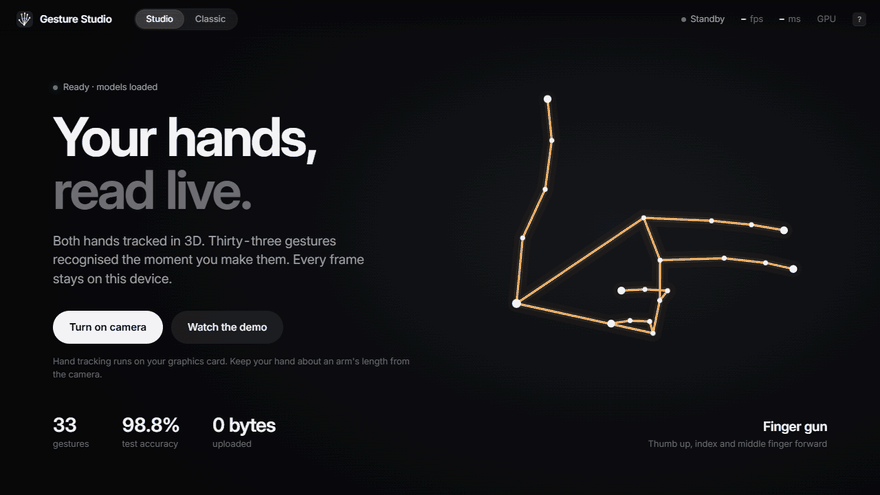</td>
<td width="50%">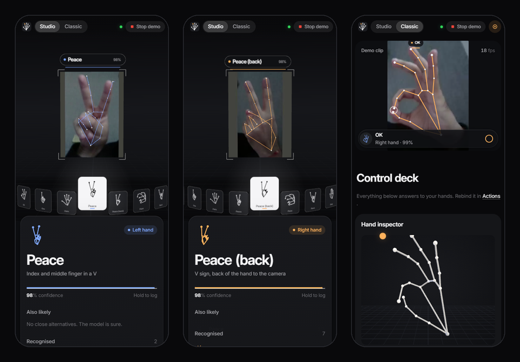</td>
</tr>
<tr>
<td valign="top"><sub><b>Start screen.</b> A hand morphs between real HaGRIDv2 poses and names each one, so a visitor learns the vocabulary before turning the camera on. It is laid out around the text by measurement, so it never overlaps it.</sub></td>
<td valign="top"><sub><b>Down to 375&nbsp;px.</b> Both views adapt to phones; the stage stays on top and the panels follow.</sub></td>
</tr>
</table>

- **Honest onboarding:** loading shows its real stages; camera errors name the cause (permission blocked, no camera, camera busy, embedded browser) and the fix.
- **Robust sessions:** a Stop control for the camera or the demo; switching between Studio and Classic keeps the session; a lost camera offers Reconnect; detection pauses in background tabs.
- **Accessible:** full keyboard control (press <kbd>?</kbd> for shortcuts), visible focus, screen-reader announcements for confirmed gestures, and `prefers-reduced-motion` / `prefers-reduced-transparency` support.
- **Fallbacks:** CPU tracking when no GPU is available; Classic takes over without WebGL.

## How it works

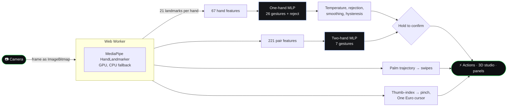

1. **Detect.** MediaPipe HandLandmarker finds up to two hands and places 21 landmarks on each. It runs in a **Web Worker**, so the page keeps rendering at display rate while the model works.
2. **Describe.** Each hand becomes 67 scale- and rotation-invariant features (angles and normalised distances); a pair of hands becomes 221 features, including their relative pose.
3. **Classify.** Two small MLPs, trained in PyTorch and exported to dependency-free JavaScript with BatchNorm folded in, score the gestures in about 1 ms. A parity test proves the JavaScript matches Python.
4. **Stabilise.** Temperature scaling, an open-set rejection class, smoothing and label hysteresis stop flicker; a gesture fires only after it is held (450 ms), once per hold.
5. **Act.** Confirmed gestures trigger the bound action; swipes come from palm speed in palm widths, and the air cursor from a One Euro filter on the index fingertip.

## Results

All test numbers are on **HaGRIDv2 subjects never seen in training**, with subject-disjoint splits ([data notes](docs/DATA.md)).

| Model | Test set | Accuracy | Macro precision |
|---|---|---|---|
| One-hand, 26 gestures | 26 gestures + no gesture (153,755 hands) | **98.8%** | **98.9%** |
| | Open set: also rejects halves of two-hand gestures (201,133 hands) | 94.7% | 95.7% |
| Two-hand, 7 gestures | Pairs of hands (44,195 pairs) | **99.3%** | **98.0%** |
| One-hand, original 6 gestures | 6 + no gesture (60,488 hands) | 99.4% | 99.2% |

- **Fairness:** gesture recall stays within 98.1–99.0% across the subjects' auto-annotated gender and race groups.
- **Calibration:** expected calibration error is 0.014.
- **Speed:** about 1 ms for the classifiers; the Python pipeline reaches about 21 FPS end to end on a laptop CPU.

<p align="center">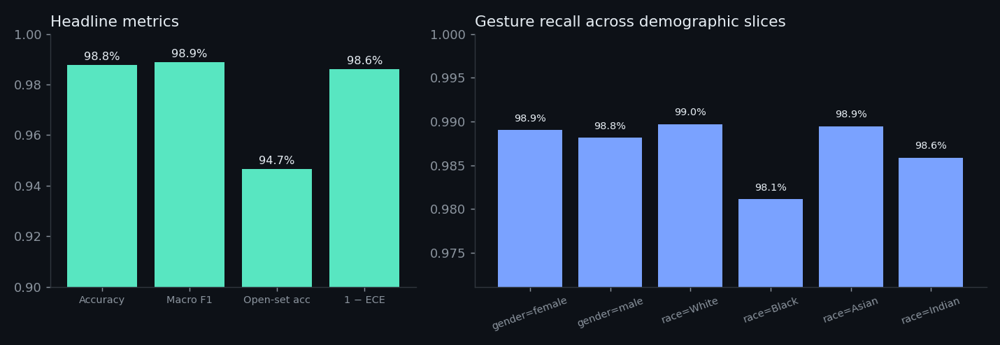</p>

<details>
<summary><b>Confusion matrix, per-gesture F1 and training curve</b></summary>

<p align="center">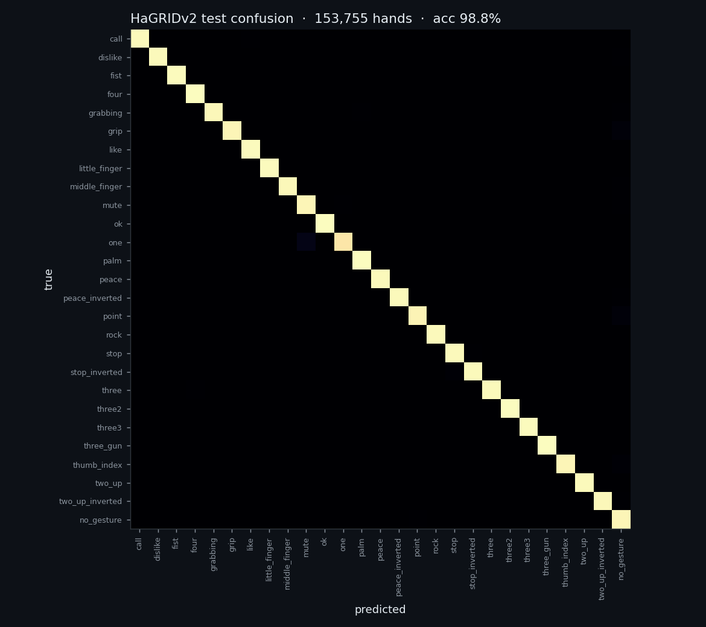</p>
<p align="center">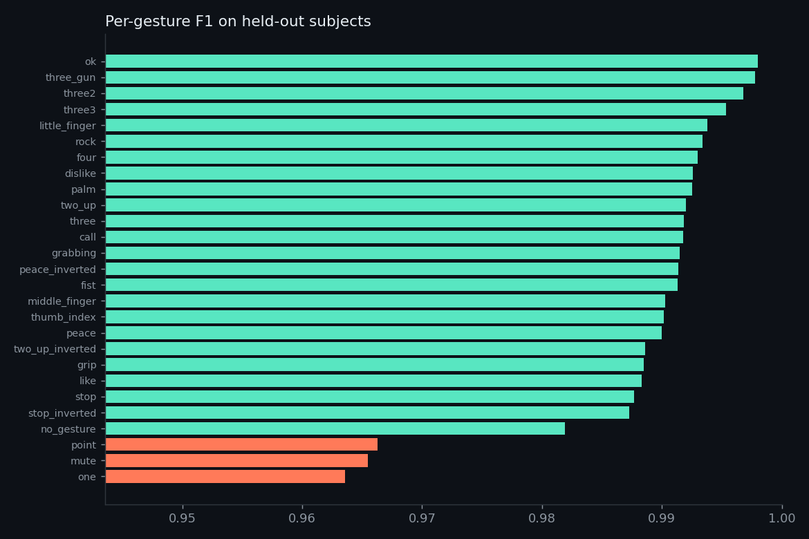</p>
<p align="center">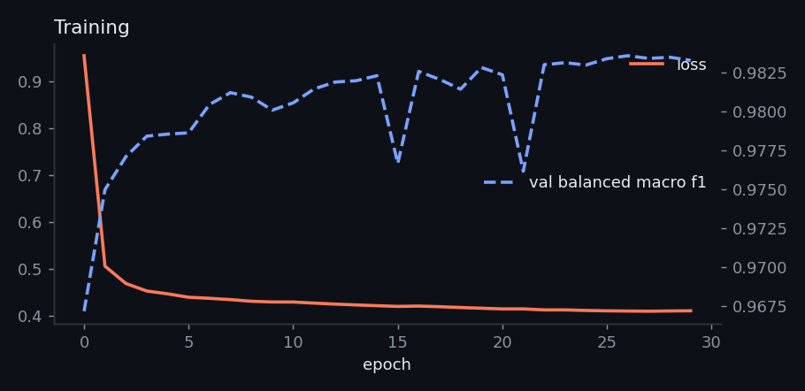</p>

</details>

### On a dataset it has never seen

Both models were run **unchanged** on [HANDS](https://data.mendeley.com/datasets/ndrczc35bt) (Nuzzi et al. 2021, CC BY 4.0): a different lab, a Kinect v2 camera, five different people. All 5 subjects, every 3rd frame: 3,504 one-hand and 498 two-hand samples ([report](reports/cross_dataset_hands.json)).

<p align="center">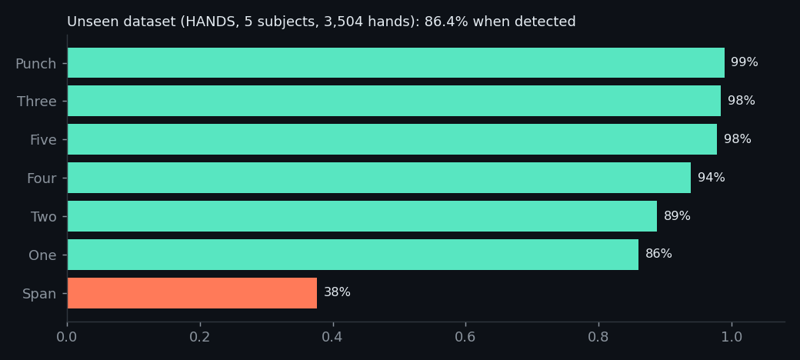</p>

| | One-hand (3,504) | Two-hand (498) |
|---|---|---|
| Hand(s) found by MediaPipe | 79.5% | 25.3% |
| **Correct, when found** | **86.4%** | **98.4%** |
| Correct end to end | 68.7% | 24.9% |
| Precision of named predictions | 87.2% | 98.4% |

The classifier transfers well (palm, fist and three at 98–99%). The two real weaknesses are elsewhere: **gesture definitions differ between datasets** (HANDS' "Span" sits between our call, pinky and rock), and **detection, not classification, limits the end-to-end number** (MediaPipe misses most hands for one subject and both hands in most two-hand frames).

The method, ablations and caveats are in [docs/MODEL.md](docs/MODEL.md). Notable findings: open-set training matters (without "other gesture" negatives, live precision drops to 32%); HaGRID's "inverted" classes are back-of-hand views; its official split leaks two subjects between train and test; and it mixes image aspect ratios its annotations don't record.

<details>
<summary><b>The Python pipeline</b> (OpenCV, used for evaluation and recording)</summary>
<p align="center">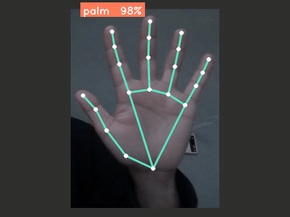</p>
</details>

## Engineering notes

Smoothness was measured, not eyeballed: frame intervals from `requestAnimationFrame` in headless Chrome on a laptop with integrated graphics, demo clip running.

| Change | Before | After |
|---|---|---|
| Hand detection moved from the main thread into a Web Worker | ~12 fps render, p50 67–83 ms per frame | p50 16.7 ms (60 fps) |
| Bloom post-processing removed (glow painted instead) | p95 133 ms | p95 17 ms |
| Live backdrop blur removed from panels over moving canvases | p95 > 30 ms | within frame budget |
| Model warmed up during loading | first result ~15 s after camera start | first result at camera start |

- **Motion model:** the tracker delivers results at camera rate; everything on screen eases towards them every display frame with frame-rate-independent springs ([`web/js/motion.js`](web/js/motion.js)), and the smoothing adapts to the measured detection interval, so motion stays continuous on slow hardware.
- **Design system:** one typeface (Inter), materials instead of lines, colour reserved for meaning (cobalt left hand, amber right, green live, red recording), tokens in [`web/css/tokens.css`](web/css/tokens.css).
- **Tests:** Python unit tests, a JavaScript/Python parity test for features and model outputs, and a syntax check of every browser module run in CI on every push. `web/tests/screenshot.mjs` and `web/tests/record.mjs` regenerate the screenshots and GIFs from the running app.

## Project layout

```text
├── web/                     the browser app: static files, no build step
│   ├── index.html           3D Studio
│   ├── classic.html         Classic workbench
│   ├── css/                 tokens.css (design system), studio3d.css, app.css
│   ├── js/
│   │   ├── tracker.js       camera, demo clips, worker pipeline, error handling
│   │   ├── landmark-worker.js   MediaPipe in a Web Worker
│   │   ├── engine.js        hold-to-confirm, swipes, pinch, air cursor, hand tracking
│   │   ├── features.js · mlp.js · custom.js · filters.js   features, classifiers, teach, One Euro
│   │   ├── studio3d.js      the 3D Studio          app.js   Classic
│   │   ├── slides.js · inspector.js · synth.js     Classic control deck
│   │   └── motion.js · hero.js · ui.js · glyph.js  springs, start screen, shared UI, pose glyphs
│   ├── models/              hand.json, pair.json (exported MLPs), poses.json, parity fixture
│   └── tests/               parity.mjs, screenshot.mjs, record.mjs
├── src/hgr/                 Python: data, features, training, evaluation, real-time pipeline
│   └── legacy/              the original 2024 SSIM template-matching version
├── scripts/                 download, cache, export, serve, figures, GIFs, cross-dataset evaluation
├── docs/                    DATA.md, MODEL.md, RESEARCH.md, UPGRADE_PLAN.md, figures/, media/, paper/
├── reports/                 evaluation outputs (JSON)
├── tests/                   Python tests
└── .github/workflows/ci.yml lint, format, tests, JS parity, module syntax
```

## Development

<details>
<summary><b>Retrain the models from scratch</b></summary>

```bash
python -m venv .venv && .venv\Scripts\activate        # Windows; source .venv/bin/activate elsewhere
pip install -e ".[dev]"
python scripts/download_hagrid.py                      # ~720 MB annotations (with landmarks)
python scripts/build_hagrid_cache.py                   # 1.31M hands -> data/processed (~30 s)
python -m hgr.train --classes hagrid --out models/gesture_mlp_hagrid.pt   # ~25 min on a laptop CPU
python -m hgr.train_pairs                              # two-hand model, ~6 min
python -m hgr.evaluate --model models/gesture_mlp_hagrid.pt --out reports/metrics_hagrid.json
python scripts/export_web.py                           # -> web/models
```

</details>

<details>
<summary><b>Checks, screenshots and GIFs</b></summary>

```bash
ruff check . && ruff format --check . && pytest -q    # Python
node web/tests/parity.mjs                              # JavaScript matches Python
python scripts/serve_web.py &                          # then, with Chrome installed:
node web/tests/screenshot.mjs                          # docs/figures/screen_*.png
node web/tests/record.mjs out/ "/?video=test-media/demo.webm&autostart" 10
python scripts/make_gif.py out/ docs/media/studio.gif
```

</details>

## Limitations and roadmap

| Limitation | Evidence | Next step |
|---|---|---|
| Gesture definitions differ between datasets | HANDS "Span" and "One" transfer poorly although the hand is found | Few-shot personalisation ("Teach", already in Classic); measure its gain |
| Detection, not classification, is the bottleneck | MediaPipe finds 25% of HANDS two-hand frames (98.4% correct when found) | Lower detection thresholds for pairs, or a stronger hand detector |
| Static gestures only | Only swipes are dynamic | A temporal model (GRU / TCN) over landmark sequences |
| Small personal test set | 33 own photos: 75.8% strict, 87.9% lenient | A larger, consented multi-person set (`scripts/record_clips.py`) |
| Demographic slices are approximate | From HaGRID's automatic face-model annotations | A sanity check, not an audit |

## From the 2024 version

The original class project compared 50×50 grayscale crops against 34 photos of one person using SSIM. It recognised 6 gestures, could not reject other hand shapes, and its on-screen "accuracy" was a similarity score. It is kept in `src/hgr/legacy/` as a baseline; the plan that took it to this version is in [docs/UPGRADE_PLAN.md](docs/UPGRADE_PLAN.md).

## Licensing and credits

> [!IMPORTANT]
> This repository does not yet include a licence file, so all rights are reserved by default. The gesture models are trained on **HaGRIDv2**, which is released under a variant of **CC BY-SA 4.0** ([terms](https://github.com/hukenovs/hagrid/blob/master/license/en_us.pdf)); check those terms before using the trained models commercially.

- **Data:** HaGRIDv2 by Nuzhdin et al. ([arXiv:2412.01508](https://arxiv.org/abs/2412.01508)); HANDS by Nuzzi et al. (CC BY 4.0) for the cross-dataset test.
- **Hand tracking:** [MediaPipe](https://ai.google.dev/edge/mediapipe/solutions/vision/hand_landmarker) by Google.
- **3D:** [Three.js](https://threejs.org). **Type:** [Inter](https://rsms.me/inter/).
