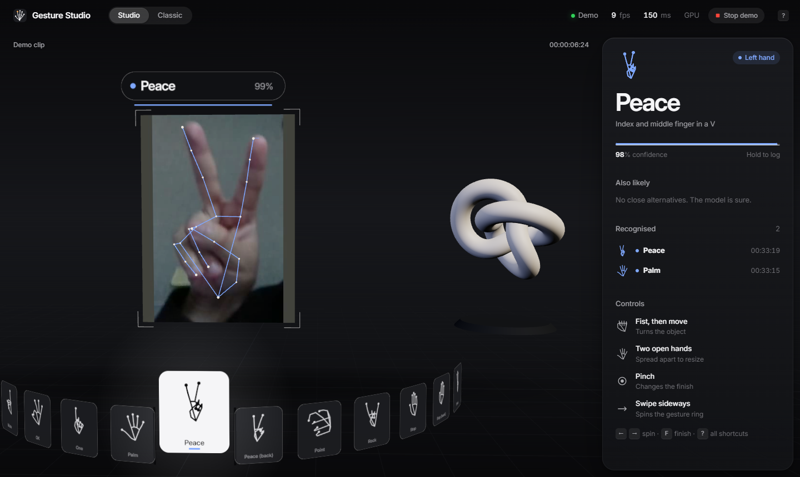
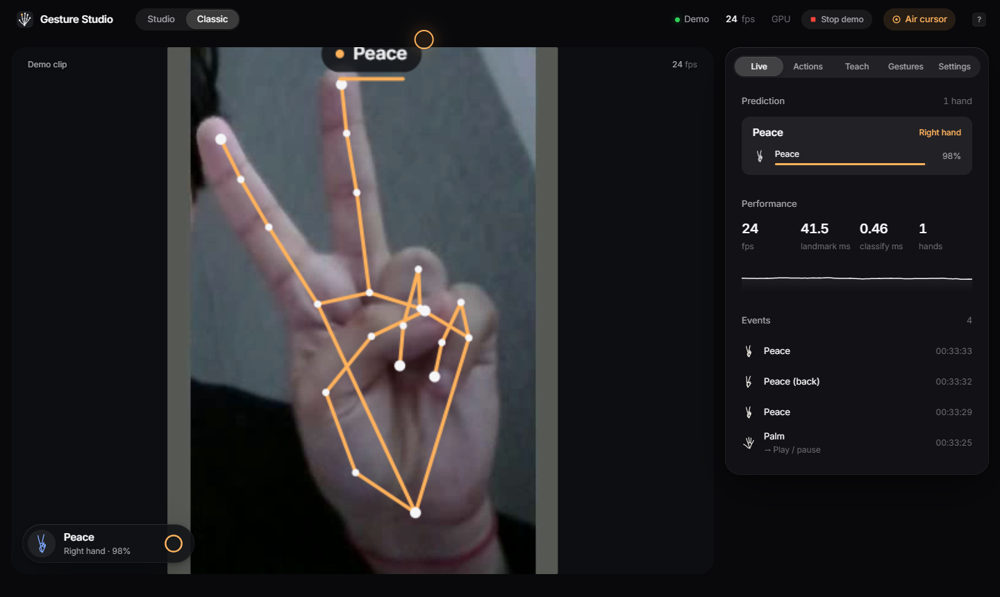
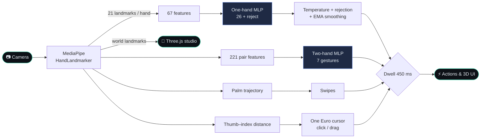

<div align="center">


# Gesture Studio 3D

**Real-time hand gesture recognition in the browser — 33 gestures, trained on 1.3M hands, private by design.**


-86.4%25%20when%20detected-7aa2ff)


<sub>The real Python pipeline running on a recorded clip: MediaPipe landmarks → MLP → smoothed label + confidence.<br/>Regenerate with <code>python scripts/make_figures.py</code>.</sub>

<table><tr>
<td align="center"><b>33</b><br/><sub>gestures</sub></td>
<td align="center"><b>98.8%</b><br/><sub>accuracy, unseen people</sub></td>
<td align="center"><b>~1 ms</b><br/><sub>classifier latency</sub></td>
<td align="center"><b>0</b><br/><sub>frames leave the device</sub></td>
</tr></table>

</div>

---

A real-time hand gesture system with a full-screen **Three.js 3D interface**. Everything runs in the browser, on-device; no video leaves the tab.
- **The scene:** your camera feed is a screen inside a 3D scene, and your tracked hands are rendered over it as 3D skeletons with depth and fingertip light trails, coloured by hand (cobalt left, amber right).
- **Gesture ring:** a 3D carousel of all 33 gestures. The one you're making flies forward.
- **Hologram:** a 3D object you control with your hands. A fist grabs and rotates it, two open hands scale it, and a pinch recolours it.
- **Motion:** hand detection runs in a Web Worker, so the scene renders at display rate while the model works; every value on screen eases with frame-rate independent springs, and the camera follows your hand with a slight parallax.

```bash
python scripts/serve_web.py      # then open http://localhost:8765 and press "Turn on camera" (or "Watch the demo" without a webcam)
```

`classic.html` is a 2D dashboard with more controls: per-gesture action bindings, teaching custom gestures, an air cursor that clicks page controls, and settings.

## Screenshots

| 3D studio (`index.html`) | Classic dashboard (`classic.html`) |
|---|---|
|  |  |
| Hand skeleton over the video screen, the 33-gesture ring, a hologram you steer with your hands, live top-5 and a gesture log. | Action bindings, teach-a-gesture, an air cursor and diagnostics. |

<sub>Real captures (GPU, 27 FPS, 35 ms) using the demo clip in place of a webcam: <code>python scripts/serve_web.py</code> then <code>node web/tests/screenshot.mjs</code>.</sub>

## What it does

| Feature | How |
|---|---|
| **33 static gestures** | MediaPipe HandLandmarker → 67 landmark features → MLP (26 one-hand classes + rejection) |
| **Two-hand gestures** (heart, prayer, X sign, timeout, frame…) | A second MLP on both hands jointly (221 features: both hands plus their relative pose) |
| **Swipes** | Palm-centre velocity over 320 ms, normalised by palm size, so it works at any distance |
| **Air cursor** | Index fingertip with a One Euro filter; pinch to click any control, pinch-drag sliders |
| **Dwell to confirm** | A gesture must be held for 450 ms to fire, once per hold; avoids accidental triggers |
| **Teach a gesture** | Few-shot nearest neighbour in the MLP's learned embedding space; saved in the browser |
| **3D interface** (Three.js, `index.html`) | Video screen in 3D space, depth-aware hand skeletons with light trails, 33-gesture carousel, hand-controlled hologram, confirmation pulses, parallax camera; detection in a Web Worker |
| **Gesture → action bindings** | Every gesture can drive a demo control deck (slides, media player, reactions, snapshots), remappable in the UI |
| **Live diagnostics** | Top-5 probabilities per hand, FPS, landmark and classifier latency, event log |

The design choices (pinch-to-click, immediate visual feedback, dwell confirmation, jitter filtering, on-device processing) follow current XR hand-tracking guidance. See [docs/RESEARCH.md](docs/RESEARCH.md) for the survey of papers, products and open-source projects behind them.

## Results

All test numbers are on **HaGRIDv2 test subjects never seen in training**, with subject-disjoint splits (see [docs/DATA.md](docs/DATA.md)).

| Model | Test set | Accuracy | Macro precision |
|---|---|---|---|
| One-hand, 26 gestures | 26 gestures + no gesture (153,755 hands) | **98.8%** | **98.9%** |
| | Open-set: also rejects halves of two-hand gestures (201,133 hands) | 94.7% | 95.7% |
| Two-hand, 7 gestures | Pairs of hands (44,195 pairs) | **99.3%** | **98.0%** |
| One-hand, original 6 gestures | 6 + no gesture (60,488 hands) | 99.4% | 99.2% |

- **Fairness:** gesture recall stays within 98.1–99.0% across the subjects' auto-annotated gender and race groups.
- **Calibration:** expected calibration error is 0.014.
- **Speed:** the classifiers run in about 1 ms. End to end, the Python pipeline reaches about 21 FPS on a laptop CPU. In the browser, the hand landmarker uses the GPU (WebGL) when available.


<p align="center"></p>

<details><summary><b>📊 Confusion matrix, per-gesture F1 and training curve</b> (click to expand)</summary>

<p align="center"></p>
<p align="center"></p>
<p align="center"></p>

</details>

### Cross-dataset test: a dataset the model has never seen

To check that the model isn't just learning HaGRID, both models were run **unchanged** on [HANDS](https://data.mendeley.com/datasets/ndrczc35bt) (Nuzzi et al. 2021, CC BY 4.0): a different lab, a Kinect v2 camera, five different people. All 5 subjects, every 3rd frame, 3,504 one-hand and 498 two-hand samples (`scripts/download_hands.py`, `scripts/eval_hands.py`, `scripts/summarise_hands.py`, [report](reports/cross_dataset_hands.json)).

<p align="center"></p>

| | One-hand (3,504) | Two-hand (498) |
|---|---|---|
| Hand(s) found by MediaPipe | 79.5% | 25.3% |
| **Correct, when found** | **86.4%** | **98.4%** |
| Correct end to end | 68.7% | 24.9% |
| Precision of named predictions | 87.2% | 98.4% |

| Subject | 1 | 2 | 3 | 4 | 5 |
|---|---|---|---|---|---|
| Hand found | 90.0% | 78.6% | **32.0%** | 98.1% | 99.0% |
| Correct when found | 81.0% | 92.2% | 95.1% | 83.0% | 87.2% |

**What this shows.** The classifier transfers well: palm, fist and three are 98–99%, four 94%, peace 89%, one 86%. The two real weaknesses are elsewhere:
- **Gesture definitions differ.** HANDS' "Span" (38%) is performed between our *call*, *pinky* and *rock* poses.
- **Detection, not classification, limits the end-to-end number.** MediaPipe misses most hands for Subject 3 and both hands in most two-hand frames. When it finds them, two-hand gestures are 98.4% correct.

The method, ablations and caveats are in [docs/MODEL.md](docs/MODEL.md). Key findings:
- **Open-set training matters:** training without "other gesture" negatives drops live precision to 32%.
- **HaGRID's "inverted" classes are back-of-hand views, not upside-down hands.**
- **HaGRID's official split leaks two subjects between train and test.**
- **HaGRID mixes image aspect ratios** that its annotations don't record.

## Architecture



The models are trained in PyTorch, then exported with BatchNorm folded into the linear layers. In the browser they run in a small, dependency-free JavaScript module. A parity test checks that the JavaScript features and probabilities match Python.

## Limitations and next steps

| Limitation | Evidence | Next step |
|---|---|---|
| Gesture definitions differ between datasets | HANDS "Span" (call) and "One" transfer poorly although the hand is found | Few-shot personalisation in the model's embedding ("Teach"), already in the classic UI; report its gain |
| Detection, not classification, is the bottleneck | MediaPipe finds 25% of HANDS two-hand frames (98.4% correct when found) and 32% of Subject 3's hands | Lower detection thresholds for pairs, or a whole-body/hand detector such as WiLoR |
| Static gestures only | Only swipes are dynamic | Temporal model (GRU/TCN) over landmark sequences |
| Small personal test set | 33 own photos: 75.8% strict / 87.9% lenient for the 33-gesture model (93.9% for the 6-gesture model) | Record a larger, consented multi-person set with `scripts/record_clips.py` |
| Demographic slices are approximate | Gender and race come from HaGRID's automatic face-model annotations | Treat the fairness numbers as a sanity check, not an audit |
| MLP on hand-crafted features | Strong in-domain, but ignores the hand's graph structure | Graph-network and transformer ablations over the 21-joint skeleton |

## Repository layout

```
├── web/                   # the browser app (no build step)
│   ├── index.html         # 3D studio (Three.js) · classic.html: 2D dashboard
│   ├── css/
│   ├── js/                # studio3d (3D app), app (classic), tracker + landmark-worker (MediaPipe off the main thread),
│   │                      # engine (dwell/swipe/pinch), features, mlp, custom, filters, motion (springs), hero, ui
│   ├── models/            # exported classifiers (hand.json, pair.json) + parity fixture
│   └── tests/parity.mjs   # JS vs Python check
├── src/hgr/               # Python: data, features, training, evaluation, real-time pipeline
│   ├── hagrid.py, splits.py, features.py, augment.py, pairs.py, labels.py
│   ├── model.py, train.py, train_pairs.py, evaluate.py, metrics.py
│   ├── landmarker.py, pipeline.py
│   └── legacy/            # the original 2024 SSIM template-matching version
├── scripts/               # download, cache, export, serve, live OpenCV demo, clip recorder/evaluator
├── docs/                  # DATA.md, MODEL.md, RESEARCH.md, figures
├── reports/               # evaluation outputs (JSON)
├── data/personal/         # 34 hand-captured photos used as an extra out-of-distribution check
└── tests/
```

## Reproduce

```bash
python -m venv .venv && .venv\Scripts\activate        # Windows; source .venv/bin/activate elsewhere
pip install -e ".[dev]"
python scripts/download_hagrid.py                      # ~720 MB annotations (with landmarks)
python scripts/build_hagrid_cache.py                   # 1.31M hands -> data/processed (~30 s)
python -m hgr.train --classes hagrid --out models/gesture_mlp_hagrid.pt   # ~25 min on a laptop CPU
python -m hgr.train_pairs                              # two-hand model, ~6 min
python -m hgr.evaluate --model models/gesture_mlp_hagrid.pt --out reports/metrics_hagrid.json
python scripts/export_web.py                           # -> web/models
pytest                                                 # includes the JS/Python parity test (needs Node)
```

## From the 2024 version

The original class project compared 50×50 grayscale crops against 34 photos of one person using SSIM (structural similarity). It recognised 6 gestures, had no way to reject other hand shapes, and its on-screen "accuracy" was really a similarity score. That version is kept in `src/hgr/legacy/` as a baseline.

## Acknowledgements

- **Data:** HaGRIDv2, by Nuzhdin et al. ([arXiv:2412.01508](https://arxiv.org/abs/2412.01508)), licensed under a variant of CC BY-SA 4.0 ([terms](https://github.com/hukenovs/hagrid/blob/master/license/en_us.pdf)).
- **Hand tracking:** [MediaPipe](https://ai.google.dev/edge/mediapipe/solutions/vision/hand_landmarker) by Google.
- **3D:** [Three.js](https://threejs.org).
