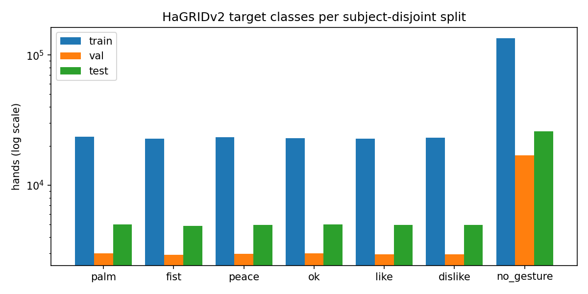
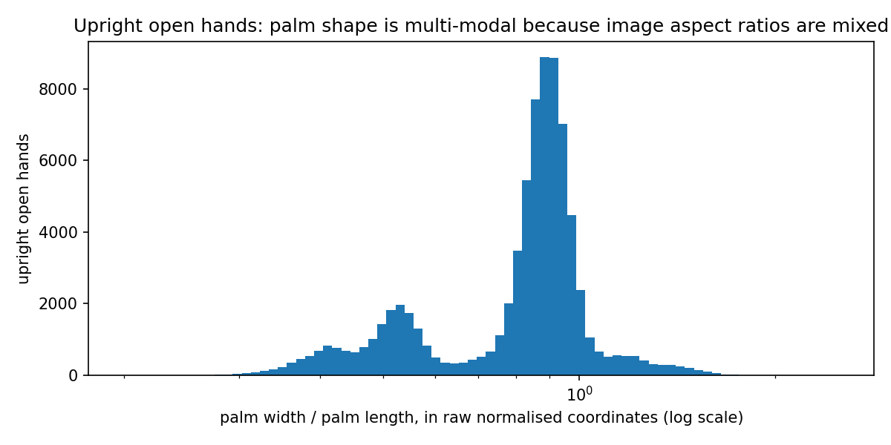

# Data

## Sources

| Dataset | Role | Licence |
|---|---|---|
| [HaGRIDv2](https://github.com/hukenovs/hagrid) annotations (boxes, labels, user ids, MediaPipe landmarks) | Train / val / test | Variant of CC BY-SA 4.0 ([terms](https://github.com/hukenovs/hagrid/blob/master/license/en_us.pdf)) |
| [HaGRID 30k 384p sample](https://huggingface.co/datasets/cj-mills/hagrid-sample-30k-384p) | Image-size probe only (JPEG headers of 400 images) | CC BY-SA 4.0 |
| `data/personal/` | Out-of-distribution test set: 1 person, 1 background, 34 photos | Author's own |

Only the annotations are used for the landmark models, so the 1.5 TB of HaGRID images are not needed.

## Reproduce

```bash
python scripts/download_hagrid.py              # ~720 MB zip -> data/raw/hagrid (4.2 GB of JSON)
python scripts/build_hagrid_cache.py           # -> data/processed/hagrid_landmarks.npz (~30 s)
python scripts/extract_personal_landmarks.py   # -> data/processed/personal_landmarks.npz
python scripts/plot_dataset.py                 # -> docs/figures/
python scripts/probe_hagrid_aspect.py          # optional: re-measures image aspect ratios
```

## HaGRIDv2 landmark cache

Each record is one annotated hand with all 21 MediaPipe landmarks (x, y normalised by image width and height).

| Split | Hands | Images | Subjects |
|---|---|---|---|
| train | 983,989 | 773,456 | 55,890 |
| val | 123,230 | 94,585 | 4,159 |
| test | 201,133 | 156,936 | 4,107 |
| **total** | **1,308,352** | | |

- **Dropped:** 195,781 annotated hands (13%) have no landmarks because MediaPipe failed on them, and are excluded.
- **Stored per hand:** the class (34 HaGRID classes), bbox, subject id, image id, a two-handed-gesture flag, and the age, gender and race of the first face in the image.
- **Caveat on demographics:** that metadata was auto-annotated per face, not per hand, and is sometimes missing.

### Target classes (hands)

| Class | train | val | test |
|---|---|---|---|
| palm | 23,659 | 2,995 | 4,991 |
| fist | 22,824 | 2,923 | 4,877 |
| peace | 23,437 | 2,958 | 4,953 |
| ok | 23,056 | 2,996 | 4,989 |
| like | 22,846 | 2,954 | 4,940 |
| dislike | 23,239 | 2,941 | 4,932 |
| no_gesture | 134,477 | 17,023 | 25,867 |



The other 27 HaGRID gestures stay in the cache. They can serve as extra hard negatives for rejection, or as extra classes.

## Findings

### 1. The official split is not fully subject-disjoint

- **The leak:** two subjects appear in both `train` and `test`. Each has 1 train image, plus 4 and 8 test images respectively.
- **Fix:** `make_subject_disjoint` moves every subject wholly into the split holding most of their samples, which moved 2 hands.
- **What the cache stores:** the corrected split as `split` and the original as `split_official`.

### 2. Image aspect ratio is unknown, and it matters

- **Why it matters:** landmarks are normalised by width and height separately. Measuring hand shape needs the image aspect, otherwise the same hand looks squashed or stretched. The annotations don't record image size.
- **Symptom:** for upright open hands (`palm`, `stop`, `four`), palm width / palm length in raw coordinates is clearly multi-modal.



- **Measurement:** to measure real sizes without downloading images, `probe_hagrid_aspect.py` range-reads JPEG headers from a public HaGRID sample. 384 of 400 sampled images matched annotation records by image id.

| Aspect (w:h) | 3:4 | 4:3 | 9:16 | 16:9 | 1:1 |
|---|---|---|---|---|---|
| Share | 66.7% | 15.2% | 9.5% | 6.8% | 1.8% |

- **Verification:** applying each image's true aspect collapses the palm ratio of portrait hands (raw median 0.95) and landscape hands (0.51) onto **0.70 and 0.71**. That matches the 0.70 from MediaPipe's metric 3D world landmarks on the personal set.
- **Consequence for training:** a single fixed aspect would distort about a third of HaGRID. The model is trained with aspects drawn from this prior (`hgr.hagrid.ASPECT_PRIOR`), so it learns to tolerate the remaining ambiguity. At inference the true camera aspect is known and is used directly.

### 3. Personal test set

- **Coverage:** MediaPipe's HandLandmarker finds a hand in 33 of 34 photos. The miss is `fist/WIN_20240601_15_10_15_Pro.jpg`.
- **Aspect:** these are crops of different sizes, so each one's true aspect is stored with it.
